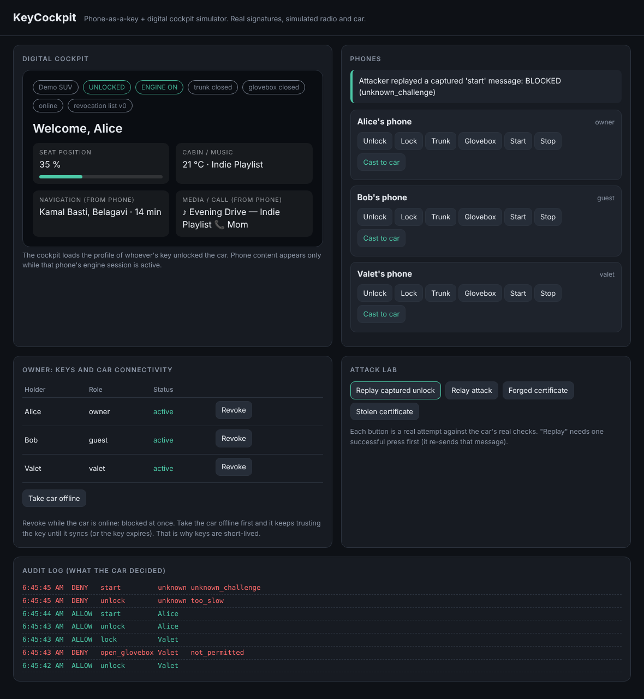

# KeyCockpit

**A phone-as-a-key and digital cockpit simulator built in Python.**

[](https://github.com/Yuvaraj-ui132/KeyCockpit/actions/workflows/tests.yml)
[](https://www.python.org/)
[](LICENSE)



---

## Overview

KeyCockpit demonstrates the core security mechanisms behind modern **digital car key systems** using real cryptography but without any physical hardware.

A simulated phone holds a signed Ed25519 digital key certificate. A simulated car ECU verifies that certificate **completely offline** using only the issuer''s public key. When the engine starts, the phone can also project navigation, media, and call information to the cockpit — the idea behind CarPlay and Android Auto.

An interactive **Attack Lab** attempts replay, relay, and certificate forgery attacks against the car''s real security checks so you can see exactly why each attempt fails.

---

## Problem Statement

In a physical car key system, the key is the credential. If you steal the key, you get the car.

Digital car keys solve this in two ways:

1. **The phone holds a private key that never leaves it.** The certificate that proves who you are is public. Without the private key, the certificate is useless.
2. **A certificate ties a specific phone to a specific vehicle for a limited time, for a limited role.** Even if someone copies the certificate, they cannot sign the car''s challenge without the matching private key.

KeyCockpit implements both mechanisms with production-grade Ed25519 signatures and shows how role-based permissions, revocation, and offline certificate verification work end-to-end.

---

## What Is Real and What Is Simulated

| Real | Simulated |
|---|---|
| Ed25519 digital signatures (`cryptography` package) | Radio link (BLE / NFC / UWB) — replaced by function calls and HTTP |
| Signed key certificates, verified by the car with the issuer''s **public key only** | The vehicle itself — a state machine in `car.py` |
| One-time challenge / response with replay protection | Phone secure hardware — the private key is a Python object in memory |
| Signed revocation lists with monotonic version numbers | Physical distance — approximated with a response-time limit |
| Role-based permissions embedded in signed certificates | |
| Audit log for every allow / deny decision | |
| Driver profile persistence (seat, temperature, music, theme) | |
| Offline certificate verification (no internet connection needed) | |

> Real vehicles follow the Car Connectivity Consortium **Digital Key 3.0** standard and use NFC for pairing and UWB for distance measurement. This project does not implement that standard; it demonstrates the concepts behind it.

---

## Key Features

- **Ed25519 certificates** — the car verifies certificates with only the issuer''s public key, no server call needed
- **Challenge / response handshake** — each command requires a fresh one-time nonce; replayed messages are rejected
- **Role-based access** — owner, guest, and valet roles with different permission sets
- **Signed revocation lists** — online revocation propagates instantly; offline cars apply it when they reconnect
- **Short-lived keys** — certificates expire, limiting the damage window if a phone is stolen
- **Attack Lab** — four attacks run against the car''s real security code (replay, relay, forged cert, stolen cert)
- **Offline / online simulation** — toggle the car''s connectivity to see how revocation behaves with no signal
- **Driver profiles** — seat position, cabin temperature, music preset, and theme loaded per driver on unlock
- **Phone projection** — nav, media, and call data pushed to the cockpit screen while the engine runs
- **No build step** — the entire frontend is one HTML file; the backend is pure-Python with three dependencies

---

## System Architecture

```
 Owner (bearer token)
        |
        v
 Backend (Starlette API + SQLite)
        |                           |
        | signed certificate        | signed revocation list
        v                           v
   Phone Simulator              Car ECU Simulator
   (phone.py)                   (car.py)
        |                           ^
        | challenge request         |
        +---------------------------+
        | certificate + signed answer
        +---------------------------+
                                    |
                               ok / deny
                                    |
                                    v
                          Cockpit Dashboard
                          (static/index.html)
```

The car object holds **only the issuer''s public key**. It never contacts the backend to decide whether to open. This is the central design point: a car in an underground car park with no mobile signal can still cryptographically verify a digital key.

---

## Technology Stack

| Component | Technology |
|---|---|
| Language | Python 3.10+ |
| HTTP framework | Starlette (ASGI) |
| ASGI server | Uvicorn |
| Cryptography | `cryptography` package — Ed25519 (hazmat layer) |
| Database | SQLite (Python standard library) |
| Frontend | Single HTML file — plain HTML, CSS, JavaScript (no build step) |
| Testing | Python `unittest` + `pytest` |
| CI | GitHub Actions |

---

## Project Structure

```
keycockpit/                <- Python package
  __init__.py              Package version
  __main__.py              Entry point: python -m keycockpit
  crypto.py                Ed25519 helpers, URL-safe base64, canonical JSON
  protocol.py              Exact bytes a phone signs per command
  issuer.py                KeyIssuer: issues certificates, signs revocation lists
  car.py                   Simulated ECU: all 9 security checks in handle()
  phone.py                 Simulated phone: generates key pair, signs challenges
  store.py                 SQLite: vehicles, keys, audit log, driver profiles
  app.py                   Starlette API + demo endpoints (owner, car radio, lab)

static/
  index.html               Cockpit dashboard SPA (no dependencies)

tests/
  test_car.py              38 unit / security tests directly against the Car
  test_api.py              24 end-to-end tests through the ASGI interface

docs/
  dashboard.png            Screenshot for the README

demo.py                    Terminal walkthrough (no server needed)
requirements.txt           Three dependencies: starlette, uvicorn, cryptography
```

---

## Digital-Key Lifecycle

```
1. Owner creates a vehicle
      POST /api/vehicles
      <- { vehicle_id, owner_token, issuer_public_key }

2. Owner enrolls a phone (supplies the phone''s Ed25519 public key)
      POST /api/vehicles/{id}/keys
      Body: { holder, role, phone_public_key, valid_minutes }
      <- { key_id, certificate: { payload: {...}, sig: "..." } }

3. Phone stores the certificate (public) and keeps the private key private

4. To use the car, the phone runs a two-step handshake:
      POST /car/challenge   <- { challenge_id, nonce }
      Signs: { v, vehicle_id, challenge_id, nonce, key_id, command }
      POST /car/command     Body: { certificate, challenge_id, command, signature }
      <- { ok: true, ... }  or  { ok: false, reason: "..." }

5. Owner revokes (phone lost, access withdrawn)
      DELETE /api/vehicles/{id}/keys/{key_id}
      Car receives a new signed revocation list instantly if it is online
```

---

## Cryptographic Verification Workflow

Every `car.handle(certificate, challenge_id, command, signature)` call runs these checks **in order**:

| Step | Check | Denial reason |
|---|---|---|
| 1 | `challenge_id`, `command`, `signature` are strings | `bad_request` |
| 2 | `command` is one of the six valid commands | `unknown_command` |
| 3 | Challenge exists in the car''s open-challenge map (and is consumed) | `unknown_challenge` |
| 4 | Challenge was issued less than 150 ms ago (relay defense) | `too_slow` |
| 5 | Certificate payload is signed by the trusted issuer''s private key | `bad_certificate` |
| 6 | Certificate `vehicle_id` matches this car''s ID | `wrong_vehicle` |
| 7 | Current time is within `[not_before - 60s, not_after)` | `not_yet_valid` / `expired` |
| 8 | Key ID is not on the revocation list | `revoked` |
| 9 | Signature over `{ v, vehicle_id, challenge_id, nonce, key_id, command }` is valid for the phone public key in the certificate | `bad_signature` |
| 10 | Command is in the certificate''s `perms` list | `not_permitted` |
| 11 | If engine is running, the commanding key must be the one that started it | `in_use` |

Only after all eleven checks pass does the car change state.

---

## Role-Based Permissions

| Role | Commands allowed | Max key lifetime |
|---|---|---|
| `owner` | lock, unlock, open_trunk, open_glovebox, start, stop | 30 days |
| `guest` | lock, unlock, open_trunk, start, stop | 7 days |
| `valet` | lock, unlock, start, stop | 12 hours |

Permissions are embedded in the signed certificate and enforced at the car.

---

## Security and Attack Lab

Each row below corresponds to a test in `tests/` and a button in the Attack Lab tab:

| Attack | What the attacker has | Why it fails | Car response |
|---|---|---|---|
| **Replay** | A recorded valid unlock message | The challenge is consumed on first use | `unknown_challenge` |
| **Relay** | A way to forward the challenge to the real phone far away | The correct answer arrives late | `too_slow` |
| **Forged certificate** | Their own signing key | Not signed by the trusted issuer | `bad_certificate` |
| **Stolen certificate** | A copy of Bob''s certificate | Cannot sign without Bob''s private key | `bad_signature` |
| **Edited certificate** | A valet key modified to say "owner" | Any payload change breaks the signature | `bad_certificate` |
| **Key for another car** | A real certificate for a different vehicle | `vehicle_id` is inside the signed payload | `wrong_vehicle` |
| **Expired key** | An old guest key | Validity window is in the signed certificate | `expired` |
| **Revoked key** | A key the owner has revoked | Car holds a signed revocation list | `revoked` |
| **Hijack running car** | A guest key while the owner drives | Only the key that started the engine may command | `in_use` |
| **Un-revoking** | An old revocation list replayed | Lists have monotonically increasing versions | list rejected |
| **Hijack cockpit** | A guess at the projection session token | Needs the session token from engine start | `403 Forbidden` |
| **Unauthorized API** | No token or the wrong vehicle''s token | Owner endpoints require `Authorization: Bearer <token>` | `401 Unauthorized` |

---

## Offline and Online Simulation

The car operates correctly with **no network connection**. Revocation propagation when offline:

```
1. Owner revokes Bob''s key — car is offline
      DELETE /api/vehicles/{id}/keys/{key_id}
      <- { revoked: true, car_updated: false, note: "car is offline..." }

2. Bob''s key is revoked on the server but the car has not received the list yet.
   Bob can still unlock (this is the honest limitation of offline revocation).

3. Owner brings the car back online
      POST /api/vehicles/{id}/car/connectivity  { "online": true }

4. Car receives the signed revocation list immediately.
   Bob''s next attempt is rejected with { reason: "revoked" }.
```

---

## Installation

**Requirements:** Python 3.10 or newer.

```bash
# Clone the repository
git clone https://github.com/Yuvaraj-ui132/KeyCockpit.git
cd KeyCockpit

# Create and activate a virtual environment (recommended)
python -m venv .venv

# Windows
.venv\Scripts\activate
# macOS / Linux
source .venv/bin/activate

# Install dependencies
pip install -r requirements.txt
```

---

## Environment Configuration

| Variable | Default | Description |
|---|---|---|
| `PORT` | `8000` | Port the demo server listens on |
| `KEYCOCKPIT_DB` | `:memory:` | SQLite path; use a file path to persist across restarts |
| `KEYCOCKPIT_MAX_RESPONSE_MS` | `150` | Relay defense timing window in milliseconds |

Example (macOS / Linux):

```bash
KEYCOCKPIT_DB=./keycockpit.db PORT=9000 python -m keycockpit
```

Example (Windows PowerShell):

```powershell
$env:KEYCOCKPIT_DB = ".\keycockpit.db"
$env:PORT = "9000"
python -m keycockpit
```

---

## How to Run

### Web dashboard

```bash
python -m keycockpit
# Open http://127.0.0.1:8000
```

Guided walkthrough:

1. **Phone & Car Access** — select Alice''s phone, press **Unlock**, then **Start Engine**, then **Cast to Car**.
2. **Attack Lab** — run all four attacks and read why each is blocked.
3. **Digital Keys** — take the car offline, revoke Bob''s key, bring it back online, watch the revocation sync.
4. **Driver Profiles** — see how seat and climate settings load per driver on unlock.

### Terminal walkthrough (no server needed)

```bash
python demo.py
```

Runs seven scenarios in the terminal showing each car decision with ALLOWED / DENIED and the exact reason code.

---

## How to Execute Tests

```bash
# Using pytest
python -m pytest -p no:cacheprovider -v

# Using unittest
python -m unittest discover -s tests -t . -v
```

Expected: **62 tests, 0 failures**.

Test categories:
- `TestNormalUse` — full drive cycle, offline verification
- `TestReplayAndBinding` — challenge one-time use, cross-command/cross-challenge protection
- `TestRelayAttack` — timing enforcement
- `TestCertificates` — forged authority, tampering, expiry, stolen cert, garbage input
- `TestRevocation` — revoke, replay old list, forged list, auto-lock on revocation
- `TestPermissionsAndState` — role enforcement, state machine rules
- `TestProjection` — session token, content sanitisation
- `TestIssuer` — validity caps, invalid input rejection
- `TestOwnerAuth` — bearer token enforcement, cross-vehicle isolation
- `TestKeyLifecycle` — issue, list, revoke, offline gap, persistence across restart
- `TestAttacksOverHttp` — replay, relay, audit integrity
- `TestCockpit` — profile loading, projection session, token not leaked
- `TestDemoMode` — full demo flow, attack lab, dashboard serving

---

## API Overview

Owner endpoints require `Authorization: Bearer <owner_token>`.

### Owner API

| Method | Path | Purpose |
|---|---|---|
| `POST` | `/api/vehicles` | Create a vehicle; returns `vehicle_id` and `owner_token` |
| `POST` | `/api/vehicles/{id}/keys` | Issue a key: `holder`, `role`, `phone_public_key`, `valid_minutes` |
| `GET` | `/api/vehicles/{id}/keys` | List keys with status (active / expired / revoked) |
| `DELETE` | `/api/vehicles/{id}/keys/{key_id}` | Revoke a key; pushes updated signed list to the car if online |
| `POST` | `/api/vehicles/{id}/car/connectivity` | `{ "online": false }` — simulate a car with no signal |
| `PUT` | `/api/vehicles/{id}/profiles/{holder}` | Save driver profile (seat, temp, music, theme) |
| `GET` | `/api/vehicles/{id}/audit` | Last 100 allow / deny events |

### Car Radio API

| Method | Path | Purpose |
|---|---|---|
| `POST` | `/api/vehicles/{id}/car/challenge` | Get a one-time `{ challenge_id, nonce }` |
| `POST` | `/api/vehicles/{id}/car/command` | Send `{ certificate, challenge_id, command, signature }` |
| `POST` | `/api/vehicles/{id}/cockpit/projection` | Push nav / media / call (requires engine session token in Authorization) |

### Dashboard API

| Method | Path | Purpose |
|---|---|---|
| `GET` | `/api/vehicles/{id}/cockpit` | Car state, active driver profile, projection data, recent events |

### Demo API (demo mode only)

| Method | Path | Purpose |
|---|---|---|
| `GET` | `/api/demo` | Demo vehicle ID, owner token, phone list |
| `POST` | `/api/demo/phones/{name}/press` | Virtual phone runs the full handshake |
| `POST` | `/api/demo/phones/{name}/project` | Virtual phone pushes projection data |
| `POST` | `/api/demo/attacks/{kind}` | Simulated attack: `replay`, `relay`, `forged_cert`, `stolen_cert` |

---

## Limitations

- **Software relay defense.** The 150 ms timing limit teaches the concept. Real systems use UWB time-of-flight measurement.
- **Revocation requires connectivity.** An offline car keeps trusting a revoked key until it reconnects or the key expires.
- **Simple owner authentication.** One bearer token per vehicle, no HTTPS, no rate limiting. Do not expose to the internet.
- **Private key stored in SQLite.** Production systems use an HSM or cloud KMS. A real phone uses the Android Keystore or a Secure Element.
- **No pairing ceremony.** A real car verifies that the person enrolling a key is physically present.
- **Single process, in-memory car state.** Fine for a demo; not designed for scale.
- **Demo owner token is a public constant.** `demo-owner-token` — demo only.

---

## Disclaimer

**KeyCockpit is a software simulator for educational and portfolio purposes.**

It does not control any real vehicle. It does not implement the CCC Digital Key standard. It uses no real Bluetooth, NFC, or UWB radio hardware. The distance-bounding mechanism is a software approximation, not real physical distance measurement.

The cryptographic primitives (Ed25519 signatures, canonical-JSON signing, challenge / response) are the same algorithms used in real systems, but the surrounding infrastructure (key storage, transport security, pairing ceremony, hardware attestation) is simplified for demonstration.

Do not use this code to secure any real-world system without a thorough security review and appropriate hardening.

---

## License

[MIT](LICENSE)
